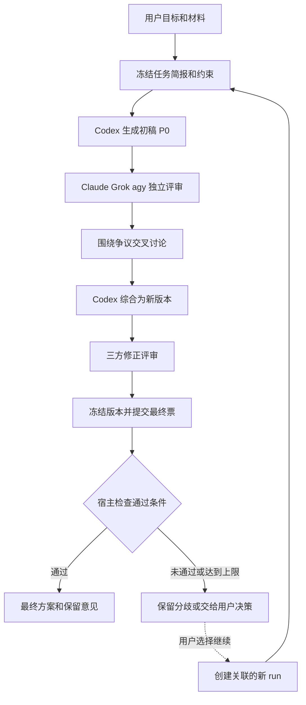
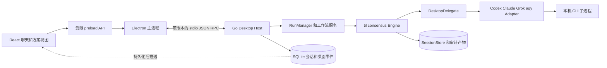

# 桌面多模型共识应用设计

版本：设计草案 v0.1  
日期：2026 年 10 月 20 日  
当前源码目录：仓库内 `desktop/`（本文保留独立项目阶段的初始设计）
参考内核：`til-consensus`，提交 `b505773800a46c54d4e32a2c0f79f13b1b416087`

实现更新：本文保留最初设计。`0.4.0` 新讨论默认先自动检查话题再选择三种模式，并支持文本材料分析；当前行为以[话题准备说明](topic-preparation.md)和[实现与验收说明](implementation.md)为准。

建议将应用设计为一个由确定性程序主持的方案讨论室：用户提出问题，Codex 生成初稿，Claude Code、Grok Build 和 agy 独立评审并交叉讨论，Codex 综合修订，三位评审对同一版本表态，应用依据规则给出结论。聊天展示发言过程，方案、争议和投票则作为独立对象保存。

技术上采用 **Electron + React + TypeScript 界面，以及 Go 后台进程复用 til-consensus 内核**。先支持 macOS、本机已有 CLI 登录和单用户使用。默认采用自由辩论；证据核查使用裁决模式；候选排序和估计使用德尔菲模式。

本阶段交付设计，后续实现以本文定义的协议、边界和验收标准为依据。

## 1 产品目标和范围

用户需要在一个聊天窗口内完成“提出问题 → 阅读初稿 → 观察多方讨论 → 查看修订 → 获得可追溯结论”。真正需要保存的是方案怎样变化、哪些反对意见被解决、哪些问题仍然悬而未决。

第一版应具备：

- 调用本机四个 CLI，并显示参与者、阶段、运行情况和输出。
- 支持 `free_debate`、`adjudication`、`delphi` 三种模式，以及每种模式的专属结果视图。
- 保存方案版本、争议、证据、投票、少数派意见和失败记录。
- 支持停止、从完整检查点继续、补充约束后发起新一轮讨论。
- 导出可阅读的 Markdown 方案与机器可读的 JSON 结果。

首版不包含团队协作、云端同步、插件市场或自动修改业务代码。讨论完成后可导出实施任务；实际执行代码变更作为独立阶段后续接入。已有 CLI 登录由各 CLI 管理，应用不另建四套账号系统。

“本地应用”指调度和记录保存在本机；模型请求仍由各 CLI 发往对应服务。

## 2 关键设计决策

| 决策 | 选择 | 原因 |
| --- | --- | --- |
| 主持者 | Go 中的确定性协调器 | 阶段、超时、投票和停止条件可测试、可恢复 |
| 默认讨论方式 | Codex 初稿，加三方评审的自由辩论 | 贴合目前的使用目标，能保留分歧并综合修订 |
| Codex 权限 | 提案者和综合者，默认不投评审票 | 提案质量由外部评审判断 |
| 协议内核 | 复用 til-consensus 的公开 Go 包 | 保留已有三模式、checkpoint、schema 和审计语义 |
| 桌面框架 | Electron + React + TypeScript | 便于实现聊天、原生进程管理和桌面交互 |
| 进程边界 | UI → Electron 主进程 → Go sidecar → CLI | 运行状态和模型进程统一归 Go 管理 |
| 上下文 | 每个任务使用宿主构造的上下文包 | 跨 CLI 行为一致，恢复不依赖 CLI 私有会话 |
| 第一版实时性 | 阶段实时、消息完成后展示 | 已有内核支持；逐字输出作为执行层增强 |
| 修改需求 | 新建 brief 版本和关联 run | 已投出的票始终对应明确版本 |

三种模式属于协议能力，不能仅靠三份不同提示词实现。模型可以建议下一步，只有协调器可以改变运行状态。

## 3 角色与模型的关系

Provider 是 CLI 接入；Agent 是绑定了 provider、模型和角色指令的参与者；Role 是某一阶段的职责。三者分别配置，允许以后替换模型。

| 角色 | 默认配置 | 职责和约束 |
| --- | --- | --- |
| 用户 | 人 | 定义目标、硬约束和取舍，处理无法自动解决的问题 |
| Coordinator | Go 程序 | 分配任务、校验输出、维护状态、计算收敛和终止 |
| Proposer | Codex | 提出 P0，列出假设、候选方案和待验证主张 |
| Reviewer A | Claude Code | 独立评审完整方案，首轮优先关注正确性和可维护性 |
| Reviewer B | Grok Build | 独立评审完整方案，首轮优先提出替代路线和反例 |
| Reviewer C | agy | 独立评审完整方案，首轮优先关注集成、边界和实施成本 |
| Synthesizer | Codex | 逐条回应争议，生成修订稿和变更说明 |
| Verifier | 独立检查器或指定评审 | 提交证据；模型判断与可复现检查结果分别记录 |
| Reporter | 模板加可选模型润色 | 从最终结构化结果生成报告，不改变判定 |

评审关注点用于引导覆盖范围，不代表某模型天然擅长该领域。每位评审都必须审阅整体方案。多个角色绑定到同一 provider、模型或原生会话时，不增加独立票数；重复身份由配置校验阻止。

Codex 同时承担起草和整合时使用不同任务上下文。它不能通过“我已采纳”单方面关闭阻塞问题，也不能代替三位评审提交支持意见。

## 4 默认用户流程



1. 用户输入需求，可选择项目目录、附加文件和讨论模式。默认只需要输入框；角色、轮数等放在可展开设置中。
2. 应用提取目标、硬约束、成功标准和范围。影响路线的缺失信息集中询问一次，其余作为显式假设进入初稿。
3. Codex 返回 P0、关键主张和风险。聊天中展示可阅读方案，右侧同步显示方案卡片。
4. 三位评审并行获得同一 P0 和材料。首轮彼此不可见，完成后统一公布，降低相互模仿。
5. 后续轮次围绕带 ID 的争议回应。界面显示本轮新增意见和方案变更，完整原文可展开。
6. Codex 综合修订；所有未采纳意见必须有理由，阻塞意见需要复评或证据才能关闭。
7. 协调器冻结待投版本。投票有效性、支持程度、硬约束和方案相容性全部检查后才产生最终结论。
8. 用户可以导出、继续讨论、补材料或选定某个取舍。人工选择带有明确记录。

## 5 三种讨论模式

### 5.1 自由辩论

适合架构、产品方案、实现路线等存在多个合理选择的问题，作为本应用默认模式。

参考流程为 `frame → ingest → initial → debate* → synthesis → amend* → final_vote → report → observe`。本应用在进入内核前增加 Codex 的 P0 生成步骤，将 P0 作为任务材料和上下文交给内核。`participants` 默认只有 Claude、Grok、agy；Codex 担任 `synthesizer`。因此三位评审在讨论和投票中地位相同。

`initial` 是三位评审针对 P0 独立提出主张和修改建议；`debate` 用于回应彼此；`synthesis` 生成统一方案；`amend` 检查综合稿是否遗漏或歪曲意见。最后对冻结的综合稿及关键原子主张投票。

建议默认配置：

| 配置 | 建议值 |
| --- | --- |
| 评审人数 | 3 |
| 辩论最少轮数 | 2 |
| 辩论最多轮数 | 3 |
| 综合稿修正轮数 | 1 |
| 每人每轮新增主张上限 | 3 |
| 活跃主张上限 | 20 |
| 支持分数聚合 | median |
| 支持分数阈值 | 0.67 |
| 有效完整评审票 | 默认 3 份，`vote_quorum = 1.0` |
| 每条关键主张的非弃权票 | 至少 2 份 |

支持分数是“对该主张的支持程度”，不是对现实正确概率的估计。除内核的聚合支持分数外，桌面策略还要求关键主张至少得到两名不同评审的明确支持。

提前停止沿用参考规则：达到最少轮数后，本轮没有新主张，所有意见都是同意或无需修改，且没有缺席，才结束讨论进入综合和最终投票。提前停止讨论不等于最终通过。

参考内核已有 `domain/process/synthesis` 分类、语义去重、来源保留、综合与修正机制。桌面应保留这些语义，避免把“请减少重复发言”一类过程意见放进最终投票。[参考模式说明](../../docs/modes.md)

### 5.2 裁决

适合“这项设计结论是否成立”“这个补丁是否解决问题”“某项性能判断是否有证据”等可验证问题。

流程为 `frame → ingest → propose → challenge → verify → revise → adjudicate → report → observe`，修订后可以再次质疑和验证。Codex 是 proposer，其他三方担任 challengers；Verifier 按需运行预先定义的检查或整理证据。

仲裁角色优先配置为与提案者不同的 agent，并与证据完整性规则共同工作。需要人工选择的价值取舍应返回 `needs_human`，不交给仲裁模型凭偏好决定。若三位评审之一兼任仲裁，应在结果中显示角色重合；更严格的配置可以增加独立仲裁实例。

每项主张保留 `keep / keep_with_caveat / unresolved / reject`、证据引用和适用条件。缺少证据的事实判断不得因为多位模型重复认可就标记为已验证。模型的语义验证意见也必须标明来源类型。

建议验证和修订各最多两轮，仲裁回退目标显式设为 `stop`，达到上限或无实质变化后保留未解决问题。若以后启用仲裁回退，全部回退调用纳入同一 run 总预算，不能只依赖可能重置的阶段计数。指定仲裁者执行失败时展示“仲裁失败”，不能静默改成另一种已完成裁决。[裁决实现](../../consensus/workflow_adjudication.go)、[仲裁入口](../../consensus/arbiter.go)

### 5.3 德尔菲

适合候选排序、风险评估、工期估计和主观取舍。流程为 `questionnaire → anonymous_summary → revision → … → report`。

此模式优先让参与者对同一问题独立提出或评价候选。若仍使用 Codex 初稿，它只作为匿名候选之一；把它作为唯一可见方案会保留先发锚定，界面应说明这一限制。

参与者只能看到匿名候选、评分分布、摘要和分歧，不获得其他人的品牌、原文日志或原生 session ID。聊天使用“专家 A/B/C”或直接显示聚合结果；管理界面可以查看真实身份映射，但不会将其再次提供给模型。这里的匿名范围是参与者之间，不是对本机所有者隐藏身份。

建议使用 1 至 5 分量表、至少两轮、最多四轮、三位有效响应者，并要求同一最高候选连续两轮达到共识阈值 0.8。每条候选至少有两份独立评分。

参考内核的共识度为 `1 - (最高评分 - 最低评分) / 量表跨度`；候选按均分优先排序。因此大家连续给同一候选 1 分，也可能达到 `converged`。桌面策略另设最低均分 4 分和硬约束检查：低分一致表示“一致不推荐”，不展示为方案通过。[德尔菲统计实现](../../consensus/workflow_delphi.go)

### 5.4 模式之间的衔接

首版每个 run 只使用一种模式。用户可以从一次结果创建关联 run，例如自由辩论后对关键事实做裁决，或对留下的多个可行方案做德尔菲排序。传递的是冻结结果、主张和证据引用，原投票不跨模式复用。

自动执行完整三模式链放在后续版本，避免普通问题也产生大量调用。模式推荐先使用规则和 Codex 的简短路由判断，用户始终可覆盖；不继承参考项目默认依赖 `gemini-api` 的分类配置。

## 6 收敛与通过条件

运行完成、意见收敛、方案获支持和实际执行成功分别记录，UI 不合并成一个绿色状态。

| 维度 | 示例状态 |
| --- | --- |
| 运行状态 | queued、running、completed、stopped、interrupted、failed |
| 决策状态 | supported、supported_with_caveats、rejected、no_consensus、quorum_not_met、insufficient_evidence、needs_human |
| 收敛情况 | 是否稳定、已完成轮数、未解决分歧 |
| 执行状态 | not_requested、pending、running、succeeded、failed |

自由辩论默认只有同时满足以下条件才展示“方案通过”：

1. 三位评审对同一份冻结 ballot 提交了完整有效响应。
2. 综合方案与必需主张达到支持分数阈值，且每项至少有两位明确支持者。
3. 每项关键主张至少有两份非弃权票；弃权、超时和解析失败不会增加支持。
4. 没有仍未解决的阻塞问题，必需硬约束均已满足；待验证条件仍保留在结论中。
5. 被采纳主张之间不存在未解决的互斥关系，依赖关系得到满足。

内核 outcome 与桌面 decision 分别保存：`failed`、`quorum_not_met` 或缺失综合稿不能被提升为通过。若内核因某些备选主张被否决而返回 `no_consensus`，桌面只能在统一综合稿及其必需主张满足全部条件时，显示“最终方案获支持，部分备选被否决”，同时保留原 outcome 和明确映射理由；不能把整场讨论改写成全体主张一致通过。

每张票绑定 `proposalVersionId + contentHash + ballotManifestHash`。漏票、重复 ID、未知 ID、内容摘要不符或标签与支持分数矛盾时，整张 ballot 无效。模型最多获得一次定向格式修复机会，失败后记为无效，不补造投票。

方案正文或关键主张修改后，先前投票仅作历史记录，必须对新冻结版本重新投票。host 在 adapter 边界检查版本关联；这属于桌面协议扩展，不能假设参考内核的 ballot 已含这些字段。

如果用户在启动前选择允许一名缺席，可以使用单独的降级配置：至少两份有效完整票，两位有效评审都明确支持，并显示缺席者和覆盖不足。默认运行中不自动降低门槛。人数门槛优先用整数表达，再映射到内核 quorum；三人要求两票不能直接配置为 `0.67`，因为 `ceil(3 × 0.67)` 是三票。

互斥方案通过 `decisionGroup`、`exclusiveWith` 和依赖关系建模。规则只能发现已声明的冲突；语义上潜在的矛盾还需要专门的整体一致性检查。参考内核逐条接受 claim 的结果，仍要经过这层桌面检查。[参考投票与法定人数规则](../../docs/modes.md)

达到轮数、时间或调用上限时，输出当前最佳方案、未解决争议和下一步建议，状态为 `no_consensus` 或 `needs_human`。最终投票后不回跳同一个内核 run；用户选择继续时创建关联 run，继承材料并重新投票。关联 run 独立归档，界面同时累计整条讨论链的调用数，并沿用用户为讨论链设定的预算。用户直接选定方案时记录 `decisionSource = human_override`，不会改写模型投票。

## 7 聊天窗口设计

主窗口采用三栏布局，窄窗口时右栏折叠为抽屉。

```text
┌──────────────┬──────────────────────────────────┬─────────────────────┐
│ 项目和会话   │ 当前会话                         │ 当前方案            │
│              │ 模式  阶段  参与者状态  调用数   │ P2  与 P1 比较      │
│ 新建讨论     ├──────────────────────────────────┤                     │
│ 历史会话     │ 用户需求                         │ 关键决定            │
│              │ Codex 初稿 P0                    │ 未解决问题 2        │
│              │ 第一轮独立评审                   │ 硬约束检查          │
│              │   Claude   Grok   agy            │ 投票矩阵            │
│              │ 综合修改 P1                      │ 证据和保留意见      │
│ CLI 设置     ├──────────────────────────────────┤                     │
│              │ 输入补充要求…  附件  发送        │ 导出  继续讨论      │
└──────────────┴──────────────────────────────────┴─────────────────────┘
```

消息按轮次分组，每轮内按固定参与者顺序展示，避免最快返回者获得持续的视觉优势。单条消息默认展示结论、针对的问题、建议变更和理由，原始输出折叠。逐字输出接入后只展示 CLI 公开的回答和进度，隐藏内部推理字段。

右侧提供三个核心视图：

- **方案**：当前冻结版本、历史版本、变更原因和受影响主张。
- **争议**：提出者、严重程度、相关证据、回应和关闭依据。
- **决策**：每条主张的票、缺席、弃权、支持分布和少数派意见。

三种模式共享聊天基础设施，但使用不同展示组件：辩论使用轮次和投票矩阵；裁决使用 claim、challenge、evidence、verdict；德尔菲使用匿名统计和评分变化。

用户操作保持明确：

| 操作 | 行为 |
| --- | --- |
| 停止并保留进度 | 取消当前任务，保留最后完整 checkpoint 和部分输出 |
| 继续 | 在原期限内用冻结配置恢复；过期则创建关联 run，未完成轮次可能重跑 |
| 补充要求 | 保存新 brief，停止旧 run 后创建关联新 run |
| 定向追问 | 默认先形成独立追问结果；采纳进方案后产生新版本并重新评审 |
| 排除某参与者 | 新建成员配置和关联 run，不更改历史法定人数 |
| 采用此方案 | 记录用户选择，显示保留风险，可导出实施任务 |

首版不提供含糊的“暂停”按钮；真正的轮次边界暂停需要内核增加控制钩子。

## 8 技术架构



Electron renderer 负责显示和用户输入，不直接访问 shell、凭据或原始文件系统。preload 只暴露固定的业务方法。Electron 主进程负责窗口、系统对话框、启动后台进程和转发消息；CLI 进程、讨论编排和运行持久化统一由 Go 管理。

Electron 的主进程、renderer 和 preload 边界可以支持上述划分；隔离和 IPC 校验按其官方安全建议配置。[Electron 进程模型](https://www.electronjs.org/docs/latest/tutorial/process-model)、[Electron 安全建议](https://www.electronjs.org/docs/latest/tutorial/security)

### 8.1 技术路线比较

| 路线 | 优点 | 成本 | 本项目选择 |
| --- | --- | --- | --- |
| Electron 加 TypeScript 重写内核 | 单语言业务层 | 重做三模式、恢复、投票和降级语义 | 暂不采用 |
| Electron 加 Go sidecar | 直接使用已实现的共识机制 | 双语言构建和 IPC | 推荐 |
| Tauri 加 Go sidecar | 可复用同一 Go 核心 | 额外维护 Rust 宿主和 sidecar 权限打包 | 有明确体积或团队经验要求时再评估 |

Tauri 本身支持捆绑 sidecar，属于可行替代路线；本选择主要取决于当前项目的开发成本，并非未经测量的性能或内存比较。[Tauri sidecar 文档](https://v2.tauri.app/develop/sidecar/)

### 8.2 与参考仓库的复用边界

可直接使用公开的 `consensus`、`config`、`runtime`、`store`、`observer` 等包。三种 workflow 保持在 Go 内核，桌面层只增加前置初稿、版本关联和最终通过条件。`internal/app`、`internal/artifact`、`internal/viewer` 不作为外部依赖。[Go 嵌入说明](../../docs/library.md)

无执行层定制的验证原型可以使用 `runner.Executor.RunRequest`。正式接入四个 CLI 时，采用 `consensus.NewEngine(EngineDeps{TaskDelegate: desktopDelegate, ...})`，因为当前 Executor 没有 delegate 注入字段，runtime 的 runner 注册表也不是公开扩展点。

DesktopDelegate 实现公开的 `Dispatch / Await / Cancel`，复用公开 prompt、schema、严格解码和规范化函数，并管理四个 adapter。格式修复行为需要显式实现或通过兼容的上游扩展复用，不能调用私有 repair 方法。后续可向 til-consensus 增加可选 DelegateFactory 和 runner options，保持现有 CLI 行为兼容。[Executor 边界](../../runner/runner.go)、[公开执行接口](../../consensus/interfaces.go)

桌面新增字段通过扩展 envelope 获取，不能只靠 DTO mapper 推导。评审任务的输出分为 `coreOutput` 和 `desktopReview`：前者嵌入参考任务的 JSON Schema，后者按独立 schema 包含问题严重程度、解决依据、冲突关系和条件。DesktopDelegate 的提示明确该包装格式，分别校验并持久化两部分，再只将 `coreOutput` 交给内核 decoder。纯格式修复不得更改已提交的评审意见。

已有主张使用内核 claim ID；尚未分配 ID 的初始草稿使用 `invocationId + claimDraftIndex` 关联扩展字段，再在内核分配或合并 ID 后建立可追踪映射。下一轮的桌面问题摘要在轮次开始时冻结，通过 delegate 附加到 prompt，避免同轮不同参与者获得不同状态。方案 hash 和 ballot manifest 由宿主计算，任务返回时绑定，不依赖模型自行生成正确摘要。M0 必须验证包装 schema、ID 映射和两层校验后才能进入真实评审。

初始设计允许通过 Go workspace 关联参考仓库。当前已经合仓，统一使用根 `go.work` 与 Go 1.27.1，不再依赖另一个源码目录；构建身份和发布来源以 [同仓说明](monorepo.md) 为准。

### 8.3 已有能力和需要补齐的能力

| 能力 | 参考实现现状 | 桌面工作 |
| --- | --- | --- |
| 三模式和检查点 | 已有 | 配置映射与结果展示 |
| phase 和 task 事件 | 已有 Observer | 持久化、桌面 DTO 和订阅 |
| 逐字输出 | CLI runner 完成后才返回 buffer | 新增流读取、解析和背压 |
| Grok 原生适配 | 没有 | 新增 adapter |
| 新版 agy schema | CLI 已支持，旧适配尚未利用 | 更新传输和解析 |
| 每任务 cwd | 旧 runner 未设置 cmd.Dir | 新 adapter 显式设置，禁止全局 os.Chdir |
| 原地暂停和插话 | 没有相应控制协议 | 首版停止恢复或关联新 run |
| 桌面事件恢复游标 | 原 Observer 的 seq 新建时从零开始 | 使用持久化桌面 eventId |
| Windows | 参考持久化代码依赖 Unix | 首版 macOS，Windows 单列兼容任务 |

不能把接上 Observer 描述成已获得逐字流式输出。[现有 CLI 执行器](../../runtime/cli/runner.go)

## 9 四个 CLI 的接入设计

以下为 2026 年 10 月 20 日本机版本和帮助所确认的能力。它们尚未经过本项目的真实推理、认证、权限和取消集成验收。

| Provider | 本机版本 | 非交互和结构化接口 | 设计选择 |
| --- | --- | --- | --- |
| Codex | 0.163.0 | exec、JSONL、output schema、exec resume、app-server | 首版用 exec；持续会话后续评估 app-server |
| Claude Code | 2.1.303 | print、stream-json、partial messages、JSON schema、resume | print 任务调用，后续增加文本流 |
| Grok Build | 1.0.34 | prompt file、JSON、streaming-json、streaming-messages-json、schema、agent stdio | 首版使用单次调用；ACP 独立实现 |
| Antigravity CLI | 1.4.2 | print、stream-json 输入输出、schema、conversation | 使用新版 headless 接口 |

Grok Build 的本机命令是 `grok`；不使用不存在的 `grok build` 子命令。各家的 streaming 格式分别解析，不能仅凭名字相似共用一套 parser。

Codex 官方提供 exec 的 JSONL 和 schema 输出，也提供 app-server 的 thread、turn、增量事件与审批请求。当前流程以单次阶段任务为单位，exec 更容易与参考内核对接；需要持久交互和协议级中断时再采用 app-server。[Codex 非交互模式](https://learn.chatgpt.com/docs/non-interactive-mode)、[Codex App Server](https://learn.chatgpt.com/docs/app-server)

Claude、Grok、agy 的官方 headless 文档分别确认了程序化调用和结构化输出能力。agy 的 plan 或 sandbox 选项不能据此视为整个进程只读；无权限工具还可能被软拒绝，因此退出码 0 也需要检查实际任务结果。[Claude 程序化调用](https://code.claude.com/docs/en/headless)、[Grok Headless](https://docs.x.ai/build/cli/headless-scripting)、[agy Headless](https://www.antigravity.google/docs/cli/headless/)

### 9.1 统一的适配契约

下列为拟新增的桌面接口，不代表现有 Go API：

```text
Adapter
  probe(binaryPath) -> version, capabilities
  start(TaskInvocation, EventSink) -> InvocationHandle
  cancel(invocationId) -> acknowledged | process_stopped | unknown

TaskInvocation
  invocationId, attemptId, logicalTaskKey
  providerId, agentId, modelId, role
  prompt, outputSchema, contextManifest
  cwd, permissionProfile, timeout, configHash

TaskResult
  invocationId, providerSessionId
  terminalStatus, structuredOutput, publicText
  usage, permissionDenials, artifactRefs, error
```

适配器的完成条件是合法的终态、完整结果和 schema 校验成功。不能看到第一个 `result` 字段或退出码 0 就认定整个任务成功。未知事件保留诊断并跳过；未知终态按失败或不确定处理。

### 9.2 调用方式

| Provider | 参数策略 | 长输入和结果处理 |
| --- | --- | --- |
| Codex | exec，加 read-only sandbox、显式模型、JSONL 和输出 schema | stdin 传提示，独立最终文件交叉校验；空目录场景显式处理 Git 检查 |
| Claude | print，加显式工具限制、MCP 配置限制和无交互权限策略 | stdin；JSON envelope 中提取最终结构；流事件单独解析 |
| Grok | 显式 cwd、prompt-file、plan 模式 | 首版 schema 加 JSON 结果；流模式单独走 streaming parser |
| agy | print 或 streaming stdin，加 plan、sandbox、schema | 优先使用文档定义的 stdin envelope，等待当前轮终态再提交下一轮 |

不在文档中给出一条声称适用于四家的万能命令。尤其 Grok 的 `--json-schema` 会切换 JSON 输出，不能未经验证与 streaming 参数混用；agy 的 streaming stdin 也不能同时用 `-p` 传另一份提示。

所有 CLI 使用可执行文件绝对路径和参数数组启动，长提示通过 stdin 或权限为 0600 的私有文件传递。启动时检查版本及能力，将路径、版本、有效参数摘要和模型标识存入 run 快照。模型默认值由用户设置或 CLI 可查询能力提供，不硬编码“最新模型”。

DesktopDelegate 使用基础环境白名单，只按 provider 显式传递所需的代理、endpoint 和凭据环境变量；原生登录继续由 CLI 读取。移除 `CLAUDECODE` 等无关宿主或嵌套会话标记，不完整继承桌面宿主环境。日志只记录允许的变量名，不记录凭据值。[参考环境构造](../../runtime/cli/env.go)

agy 的独立 streaming stdin 任务收到当前轮 `result` 后关闭 stdin，并等待进程正常退出。保持 stdin 打开会继续等待下一轮；关闭 stdin 也不能充当正在执行任务的取消。agy 不接受 Claude 式 `control_request/control_response`，中断必须使用单独验证的方式。

### 9.3 取消和错误处理

每次调用创建独立的进程组。取消优先使用已验证的协议或适合该 CLI 的中断信号，随后限时等待，再 TERM，最后 KILL 清理进程树。Claude 的 SIGINT 和 SIGTERM 语义不同，应按其协议单独处理。

停止本地客户端不保证服务端推理或共享 daemon 任务已停止。结果分别记录取消请求、协议确认和本地进程退出；未获确认时显示“本地进程已停止，服务端状态未知”。

错误分为启动失败、需登录、版本不兼容、限流、任务超时、权限拒绝、协议错误、schema 错误和 provider 内部错误。只对可恢复的短暂故障做有界重试；认证失败直接提示用户在原 CLI 登录。格式修复和业务重试共用单 run 调用预算，防止多层重试失控。

## 10 任务上下文和方案版本

跨模型共享的是宿主生成的上下文包，内容包括：任务简报版本、硬约束、当前方案与摘要、活跃主张、未解决问题、证据引用、本轮任务和输出 schema。

首轮评审包含同一 P0，不包含其他评审结果。后续轮次包含所有上轮已提交的有效意见，并保留原文入口。摘要用于控制长度，不能删除反对意见、条件或证据来源。输出被截断或材料超过限制时，记录截断范围并补充材料，不能把局部阅读当成完整评审。

上下文包附带 manifest、内容 hash 和文件范围。相同轮次的评审使用相同材料版本。事实材料、用户要求和其他模型发言分别标记来源；模型发言不能升级成调度指令。

默认每个任务启动独立 CLI 调用，宿主显式提供上下文。CLI 原生 session ID 仅作为诊断或后续优化；应用的 Conversation、Run、TaskAttempt 与原生 session 分别编号。并行任务禁用 `--last` 或“继续最近会话”之类隐式恢复方式。

用户补充约束后产生新的 brief 和 run，附上旧方案与差异。对原结果无影响的纯阅读追问可以单独回答，但只要修改待采用方案就需要新的版本和有效票。

## 11 数据模型

| 对象 | 关键字段 | 规则 |
| --- | --- | --- |
| Project | id、name、workspaceRef | 工作目录必须显式选择 |
| Conversation | id、projectId、title | 包含多个简报和多次运行 |
| BriefRevision | id、goal、constraints、criteria、materialsHash | 创建后不可变 |
| Run | id、mode、briefRevisionId、parentRunId、frozenConfigHash | 一次确定模式和成员的协议执行 |
| ProposalRevision | id、parentId、contentHash、changeLog | 修改内容产生新版本 |
| Claim | id、statement、category、provenance、decisionGroup、dependencies | 保留合并前来源与冲突关系 |
| Issue | id、claimId、severity、status、raisedBy、resolutionRefs | 阻塞项关闭需要依据 |
| Evidence | id、kind、source、artifactRef、verificationStatus | 区分模型意见和实际检查 |
| Ballot | voterIdentity、proposalVersionId、manifestHash、claimVotes | 唯一身份，每项恰好一票 |
| TaskAttempt | id、logicalTaskKey、invocationId、attemptId、providerSessionId | 每次调用独立，重试不覆盖 |
| Decision | coreOutcome、desktopOutcome、policyVersion、minorityReport | 保存内核结果和附加规则结果 |
| DesktopEvent | eventId、runId、attemptId、type、payload、at | 持久化游标，用于重连 |

这些是桌面领域对象。内核 DTO 通过显式 mapper 转换，不能把 Go 内部结构直接固定为永久桌面数据库协议。冲突关系、版本绑定和额外支持门槛属于新增桌面策略，原始内核结果同时保存。

## 12 持久化和恢复

首版保留 til-consensus 的文件型 SessionStore 作为协议恢复状态来源。SQLite 保存项目、会话、用户消息、版本化文档、桌面事件及可重建的运行索引；React 状态仅是视图缓存。Go 是运行状态唯一写入方。

运行快照负责“从哪里继续”，ledger 负责审计，桌面事件负责“UI 错过了什么”。现有 lifecycle events 没有包含完整运行数据，不能只凭事件流重建整个 workflow。

建议的数据布局：

```text
<app-user-data>/
  desktop.sqlite
  engine-sessions/
  conversations/<conversation-id>/
    runs/<run-id>/
      run-config.json
      context-manifest.json
      result.json
      decision.json
      summary.md
      ledger.jsonl
      ledger.root.json
      artifacts/attempt-<uuid>/
```

目录为设计示意，实际根路径使用 Electron 提供的用户数据目录。每次启动或恢复都生成新的 attempt 目录，同一 session 的审计账本继续追加。参考 runtime 的任务计数会重置，沿用同一 raw artifact 目录可能产生同名文件，必须在桌面执行层隔离。

运行恢复规则：

1. RunManager 对每个 run 获取独占 lease；同一个 run 不允许同时启动两个 engine。文件 Patch 锁不能替代这个约束。
2. 每次运行冻结 provider 配置、模型、CLI 版本、prompt 和 schema 版本、engine commit、策略版本与材料 hash。恢复使用该快照；版本无法兼容时创建新 run。
3. 从最后一个完整阶段或完整轮次 checkpoint 继续。未提交的并行轮可能整体重跑，调用语义为 at-least-once，保留所有 attempt。
4. 重启后先核对 checkpoint、结果和存活进程，再更新 SQLite 索引。不要凭最后一条 UI 消息判断任务已经完成。
5. 当前引擎的取消和 deadline 错误存在共用路径，Desktop Host 额外记录停止原因，避免把用户停止展示成预算超时。

Codex P0 和桌面最终判定发生在 Engine 外，因此另有宿主事务进度 `preparing → engine_running → finalizing → completed`。它只描述输入准备和产物提交，不复制三种模式的阶段状态机。P0 正文、结构化初稿和 hash 在 SQLite 同一事务保存，随后登记 engine session 映射；Engine 完成后，使用 finished snapshot 的结果计算桌面 decision，并以 run ID 和 policy version 幂等提交。

恢复时，已提交的 P0 不重复生成；没有提交完整 P0 的调用可能重试并保留旧 attempt。若 Engine 已完成而桌面 decision 尚未提交，只补做确定性的最终检查与报告渲染，不重新运行讨论。session 创建与宿主登记之间的崩溃通过稳定 request ID 和 SessionStore 扫描核对，防止生成第二个同名运行。

桌面事件先落盘再推送，窗口关闭或 IPC 断开不能使 Observer 返回传输错误并终止 engine；磁盘写入失败则停止派发，提示可恢复错误。内核 checkpoint 与桌面事件不是同一事务，因此恢复需要核对和补发 `state.reconciled`，不能承诺跨文件与 SQLite 的原子提交。

订阅使用持久化的 `eventId`。原 JSONL observer 的 seq 在新建实例时会归零，不直接用作重连游标。重复事件按稳定事件 ID 去重，历史 attempt 的部分文本保留为未完成记录。[参考恢复语义](../../docs/library.md)

## 13 桌面协议和事件

Electron 与 Go 使用 stdio JSON RPC，不开启本地监听端口。stdout 仅承载协议，诊断写入 stderr。启动握手交换 `protocolVersion`、`engineVersion` 和能力列表；不兼容时停止启动并显示具体版本。

建议的方法与通知：

```text
provider.probe
conversation.create
run.start
run.stop
run.resume
run.branch
run.getSnapshot
run.subscribe(afterEventId)
artifact.export

run.phase_changed
task.started
task.public_text_delta
task.completed
task.failed
proposal.revised
issue.updated
ballot.received
decision.finalized
state.reconciled
```

请求带 requestId，启动与分支操作另带 idempotencyKey，避免按钮重复提交产生多个 run。大文本和附件通过 artifact 引用读取；限制单条协议帧、输出总量及队列长度。

后续增加流式输出时，字节流必须正确处理 UTF-8、多行拆包和 JSONL 分片。公开文本增量按短时间窗口合并推送；慢 UI 可以丢弃临时渲染增量并重新读取消息快照，最终结果和关键状态事件必须可靠保存。

## 14 权限和材料边界

所有评审默认在私有 run 目录工作，获得宿主提取的材料副本和结构化上下文。原项目路径不会直接作为四个 CLI 的共同可写工作区；本机凭据仍由 CLI 自行读取，应用不复制认证文件到 run 目录。

权限分为“纯讨论”“读取项目材料”“独立验证”“实施代码修改”四种配置，首版聚焦前两种。具体限制由每个 adapter 的工具设置、CLI sandbox 和必要的 OS 限制落实。plan 是行为模式，单独使用不能承诺文件系统只读；工作树隔离也不能代替权限隔离。

Codex 使用明确的只读配置；Claude 显式限制内建工具及 MCP，不能把 `allowedTools` 当成可用工具白名单。现有用户 hooks、MCP 和插件可能在启动时加载，启动 profile 要控制这些来源，同时保留用户现有登录；不能为此默认使用会改变认证方式的 bare 配置。

Grok 和 agy 的有效权限边界必须经集成测试确认。未能满足所选权限配置的 adapter 标记为能力不足，不自动增加权限。参考仓库的 Codex workspace-write 和 agy 跳过权限参数不能直接继承为讨论默认值。

Renderer 开启 context isolation，关闭 Node integration，仅通过受限 bridge 操作；Markdown 禁止原始脚本和未过滤 HTML，外链由系统浏览器打开。材料中的路径、命令和其他模型输出按数据处理，不能直接触发 shell。

导出默认包含方案、必要证据和投票摘要。原始日志属于可选诊断包，先预览并脱敏，不包含 token、完整环境变量或认证文件。

## 15 调用预算和运行体验

建议默认总墙钟时间 15 分钟，单任务超时 3 分钟，并允许按 CLI 和任务调整。首版采用绝对期限，停止等待时间也计入，恢复不重置截止时间。Host 在准备 P0 前登记 deadline，进入 Engine 时传递剩余时间并冻结配置；Resume 沿用原 StartedAt 和期限。过期后保留结果，用户继续需创建关联 run 并选择新的期限，不能用新 context 绕过原 deadline。讨论链的历史调用消耗仍累计并受链级调用预算约束。

对同一 provider 默认串行调用，不同 provider 的独立评审并行执行，避免同账号共享会话或限额互相干扰。

默认自由辩论约需：初稿 1 次、独立评审 3 次、两轮辩论 6 次、综合 1 次、修正评审及整合 4 次、最终投票 3 次，共 18 次。语义去重、额外报告、第三轮、重试和格式修复另计，因此首版建议每 run 总上限 30 次，并在开始前展示预计范围。

主张数量、输入长度和新增问题均设上限；优先讨论阻塞问题。不同 CLI 不统一支持硬 token 预算，应用只能对它实际可控的调用数、轮数、上下文和墙钟时间强制限额。

费用字段可能缺失、为估算值或按会话累计。统一记录 usage 的来源和统计范围；仅在确认累计语义后计算差额，缺失显示“未知”，不显示为零。订阅登录也不等于无限调用。

初稿、单方评审或报告失败都应有明确位置和恢复入口。达到门槛不足时仍可展示已得到的材料，但状态保持 `quorum_not_met` 或 `failed`。

## 16 最终报告

导出的 Markdown 包含：推荐方案、满足的目标、关键设计、实施步骤、验证计划、已解决争议、保留意见、适用条件和决策来源。附录列出对应版本、参与者、有效票、缺席和关联证据。

JSON 同时保留原始内核结果、桌面策略结果、配置 hash 和 run lineage。报告正文中的每个“通过”“已验证”都必须能回到相应票或检查记录。可以使用模型润色说明，但判定字段与投票数字由代码渲染并校验。

实施任务导出包括依赖、验收标准和待验证假设，不自动执行 shell、提交或部署。以后接入执行阶段时，执行使用独立工作目录和权限，并把真实验证结果反馈成新的证据或评审 run。

## 17 项目结构建议

以下为初始目录规划，后台入口名已同步当前 TCView；项目物理目录仍名为 `newtc`：

```text
newtc/
  apps/desktop/
    main/                   Electron 生命周期与后台进程桥接
    preload/                受限业务 API
    renderer/               聊天、方案、争议和投票视图
  services/host/
    cmd/tcview-host/          Go 后台入口
    internal/rpc/           协议及 DTO 映射
    internal/runmanager/    lease、配置冻结、停止和恢复
    internal/workflow/      初稿、内核请求和桌面通过条件
    internal/delegate/      TaskDelegate 实现
    internal/adapters/      四种 CLI 的进程和协议处理
    internal/storage/       SQLite、产物和事件 journal
  packages/protocol/        桌面协议规范及生成的类型
  fixtures/                 CLI 脱敏事件与讨论场景
  docs/
    design.md
```

应用内只有一套 workflow 状态机。Go backend 使用 til-consensus 的公开包；前端不能自行决定下一轮应该派发给谁。

## 18 实施里程碑和验收

### M0 内核与桌面通信原型

建立 Electron 窗口、Go sidecar 和 mock provider。验证三模式输入输出映射、协议握手、事件保存和停止恢复。完成依赖版本固定，确认 Engine、自定义 delegate、扩展输出 envelope 和主张 ID 映射的接入路径，并验证 P0 与最终判定的宿主恢复进度。

验收：纯 mock 条件下能够完成一次三方评审，关闭窗口后重新打开仍能读取结果；同一 run 的重复启动被拒绝。

### M1 四个 CLI 和默认讨论闭环

实现四个 adapter、Codex P0、三方独立评审、自由辩论、综合修正、完整投票、桌面通过条件、版本历史和导出。提供阶段进度，消息在每次任务完成后显示。

验收：四个真实 CLI 各完成连通与协议检查；同一个任务产出完整方案、来源可追踪的修改和三张有效 ballot。实际权限边界符合所选 profile，停止后没有遗留的本地子进程。

### M2 完整三模式和恢复能力

提供裁决专属证据视图、德尔菲匿名视图、关联 run、补充需求、attempt 隔离、冻结配置恢复和缺额状态。模式内核在 M0 即可验证，M2 完成产品交互。

验收：三模式分别完成崩溃恢复场景；德尔菲参与者上下文中没有身份泄漏；旧版本的票不能批准新版本；重复恢复不会覆盖旧产物。

### M3 逐字输出和长期使用

接入各家公开文本增量、工具进度、可靠中断、上下文压缩、配置迁移、日志清理与桌面发布打包。轮次边界暂停和 Codex app-server 可在此阶段加入。

验收：流读取支持拆包和背压，断开 UI 不影响已启动讨论，升级后旧会话可读；macOS 安装包包含 Go sidecar，CLI 缺失时给出可操作状态。

第一版完成范围为 M1 和 M2；M0 是工程验证，M3 的逐字显示不阻塞正确的讨论与收敛闭环。Windows 和自动代码执行分别排期，不在首版兼容承诺内。

## 19 必须覆盖的验证场景

| 场景 | 预期结果 |
| --- | --- |
| 三位评审支持，所有硬约束满足 | supported，输出冻结方案 |
| 一位评审提出未解决阻塞风险 | 保留风险，禁止展示为自动通过 |
| 一位超时或 schema 持续失败 | 默认 quorum_not_met，不视为同意 |
| ballot 漏票、重复票、未知 claim ID | 整张票无效，有界修复后仍失败则缺席 |
| 三位都弃权 | 没有支持结果 |
| 修改 P1 为 P2 后沿用 P1 的票 | 版本校验拒绝 |
| 两个互斥技术路线同时获支持 | needs_human 或重新综合 |
| Delphi 大家持续给 1 分 | 可记录低分收敛，决策为不推荐 |
| 评分一致但硬约束不满足 | 不能通过 |
| 同一模型开两个角色 | 不产生额外独立票 |
| 用户中途修改硬约束 | 新 brief 和关联 run，不改写旧票 |
| 并行轮中崩溃后恢复 | 从完整 checkpoint 继续，保留新 attempt |
| P0 已保存或 Engine 已完成时崩溃 | 只补做未提交的宿主步骤，不重新请求已保存初稿或重跑讨论 |
| 停止后超过原绝对期限 | 不在原 run 重置时限，提示创建关联 run |
| 重复点击开始或继续 | 由 idempotencyKey 和 lease 阻止重复执行 |
| UI 关闭、事件重复或短暂丢连 | 从持久化游标和快照恢复显示 |
| CLI 无登录、未知版本或权限软拒绝 | 明确失败类型，不显示为验证成功 |
| plan 模式试图写入原项目 | 根据权限验收拒绝接入或由边界阻止 |
| 模型发言要求跳过投票或执行命令 | 按普通文本保存，调度规则不变 |
| Unicode、长行和拆分 JSONL | parser 正确拼接，输出限额可控 |

验证分为三层：纯规则和状态机测试、录制事件的 adapter 契约测试、少量真实 CLI 集成验收。默认 CI 使用 mock 与脱敏 fixtures；需要真实推理的测试单独运行，记录版本和调用消耗。讨论质量另外通过固定任务集评估：阻塞问题发现率、版本修订是否解决问题、无效通过率、少数意见保留情况和调用成本。

## 20 主要风险和后续决策

| 风险 | 应对 |
| --- | --- |
| 模型相互附和，形成表面共识 | 首轮独立、保留反例、版本化投票、证据检查 |
| Codex 起草并整合产生偏向 | 默认不投评审票，外部复评阻塞项，报告保留异议 |
| CLI 自动升级改变事件格式 | 保存版本、probe、能力门槛和录制协议测试 |
| 流程完成被误当成方案正确 | 运行、收敛、支持和执行四维展示 |
| 复用内核时复制出第二套状态 | Go 单写入，桌面仅做包装和附加检查 |
| 恢复造成重复调用和产物覆盖 | lease、attempt 子目录、配置冻结和可见重试 |
| 讨论成本随轮数快速增加 | 显式调用预算、主张上限、无进展停止 |
| 权限模式在各家含义不同 | adapter 能力声明和真实边界验收 |

后续实现前最先验证的是四个 adapter 的结构化终态、权限边界和取消行为，以及 DesktopDelegate 对内核的兼容性。这些结果决定 M1 的具体参数组合；不会改变“由程序主持、围绕版本和主张讨论、保留未解决意见”的产品主线。
